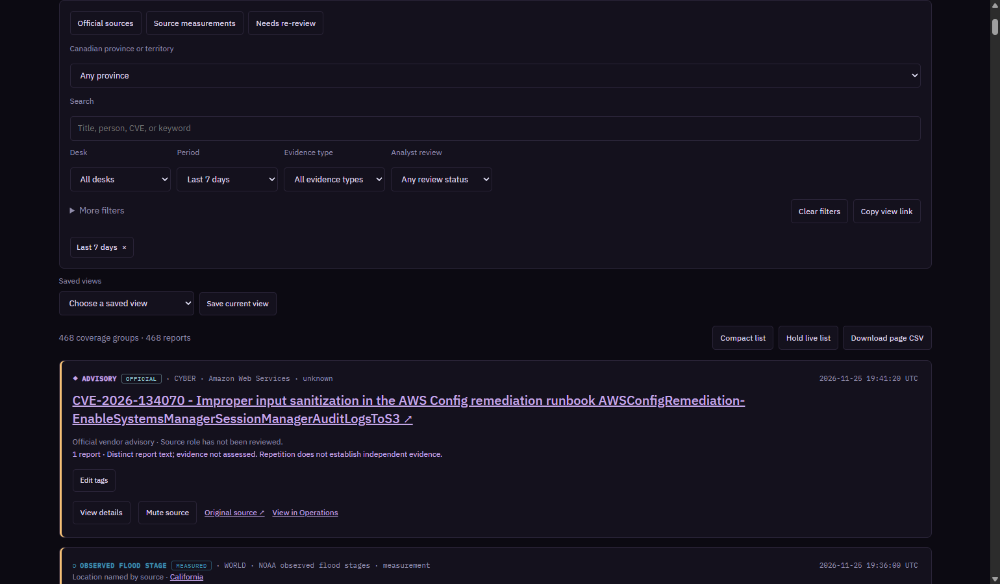
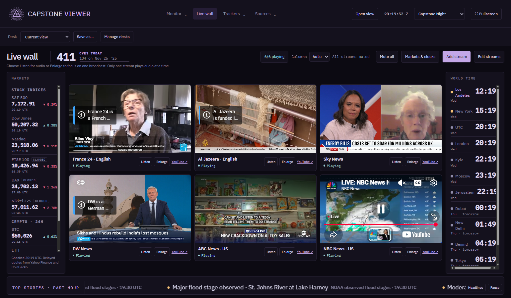
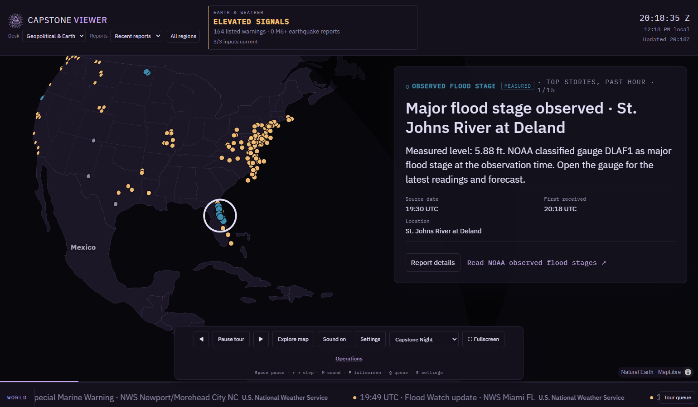
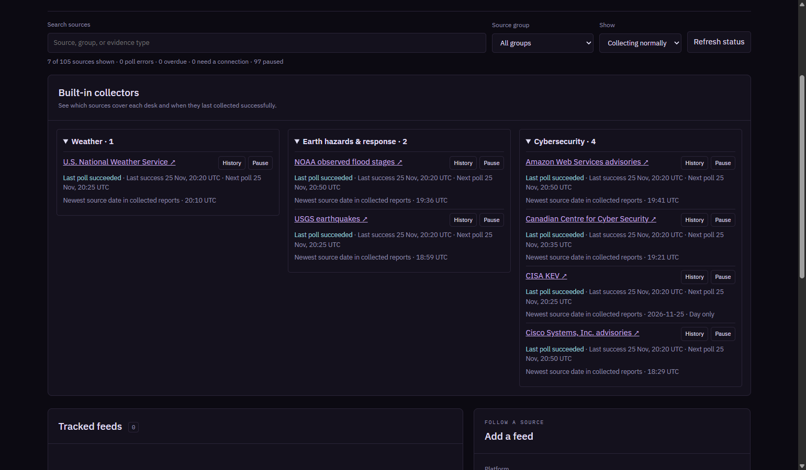
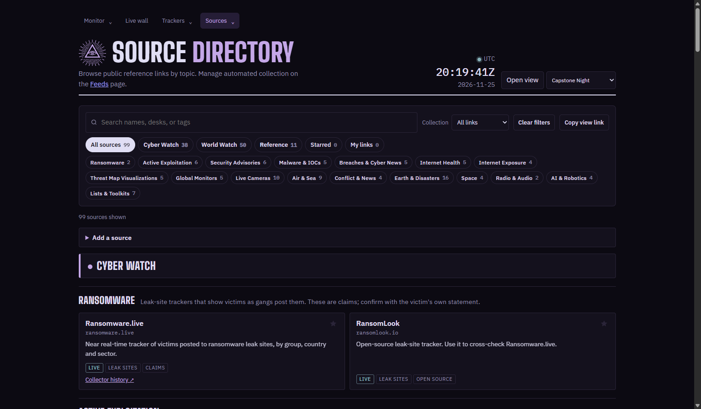

# Capstone Viewer

Capstone Viewer pulls public reports on cyber threats, internet outages, severe weather, and world events into a local dashboard. See where a report applies, check who published it, and open the original source. The Windows app can keep collecting from the system tray.

## Capstone Viewer in action

| Operations | Timeline |
| --- | --- |
| <br>Filter by topic or place and see matching reports alongside the map. | <br>Search by keyword or CVE, compare source and receipt dates, and save reports for review. |
| **Live Wall** | **Kiosk** |
| <br>Watch six broadcasts with backups, market prices, clocks, and a headline crawl. | <br>Keep a Cyber, Geopolitical &amp; Earth, or AI &amp; Robotics desk rotating on a second screen. |
| **Feeds** | **Sources** |
| <br>Check when a feed last collected and follow additional public sources. | <br>Find public reference links by topic and see which sources Capstone collects automatically. |

## Run locally

Install Node.js 24 or later.

```powershell
npm ci
npm start
```

Open [Operations](http://127.0.0.1:8080/ops). On Windows, run `npm run desktop` for the desktop app. Run `npm test` to check the project.

## Feed sources

CISA KEV, NVD, national cybersecurity centers, and vendor advisories cover cyber. IODA, RIPE RIS Live, and optional Cloudflare Radar cover connectivity. USGS, NOAA, Environment and Climate Change Canada, the FAA, state DOTs, and BBC, Guardian, and UN feeds cover hazards, transport, and world reporting. GDELT aggregates are available for source review in the timeline.

[Walkthrough and full source list](docs/walkthrough.md) · [Third-party components](THIRD_PARTY.md)
