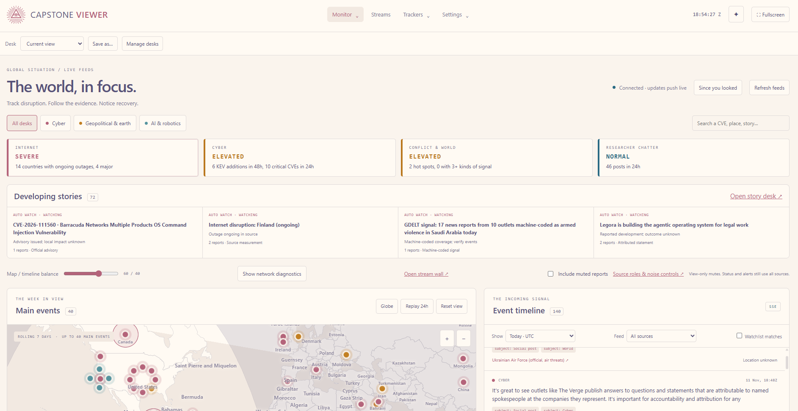
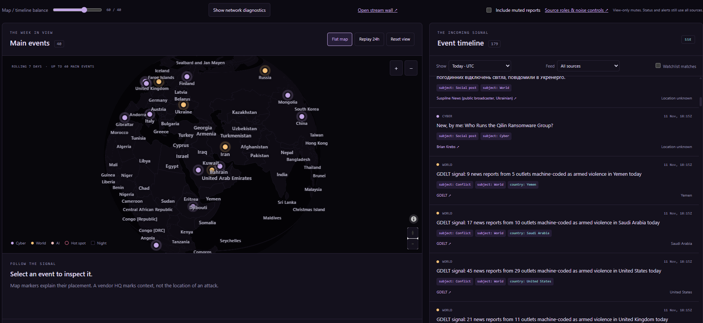
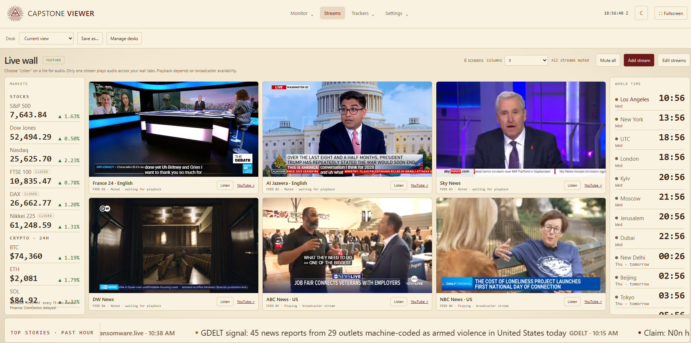
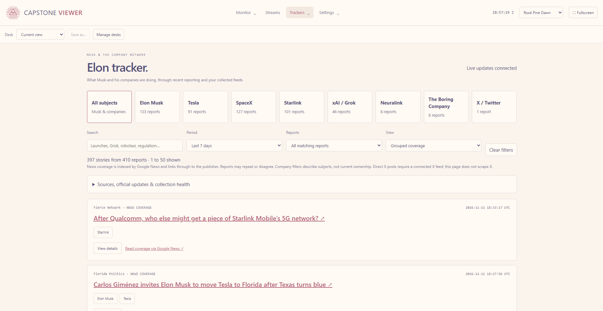
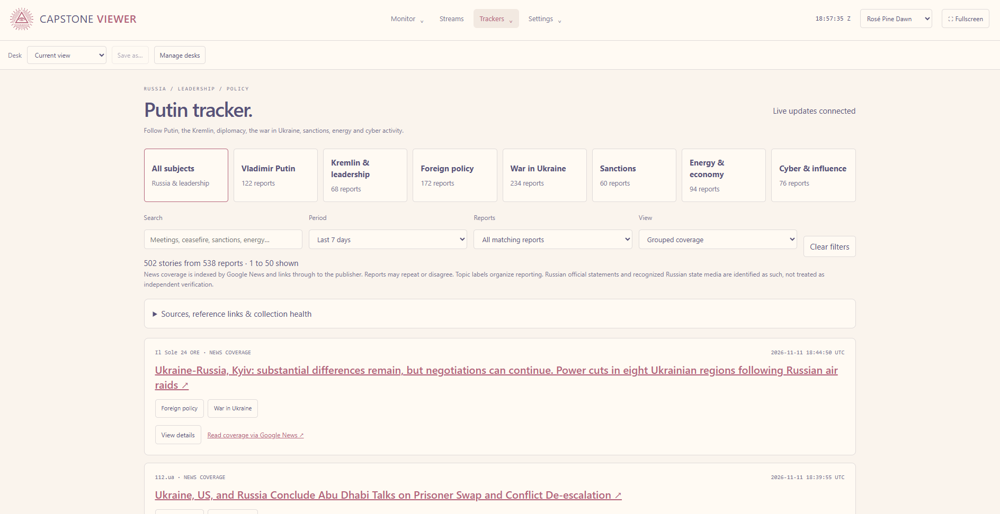
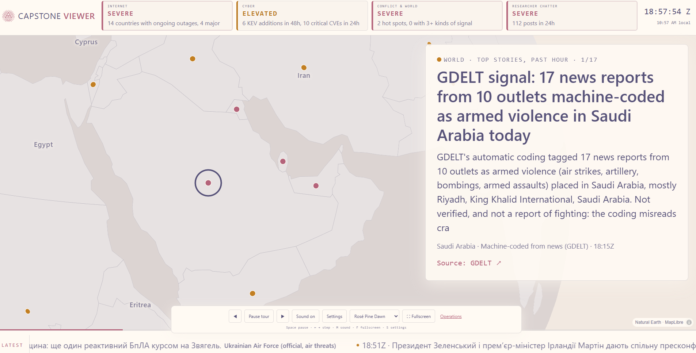

# Capstone Viewer

Capstone Viewer is a local OSINT dashboard for monitoring cybersecurity and world events. It combines public feeds, an interactive map, a searchable timeline, and a live news wall. The Windows desktop app keeps collecting from the system tray, and reports and settings stay on your device.

## Run from source

Install Node.js 24 or later, then run:

```powershell
npm ci
npm start
```

Open [Operations](http://127.0.0.1:8080/ops). On Windows, use `npm run desktop` to open the Electron app instead. The desktop app allows up to 60 seconds for the local server to start.

## Walkthrough

### Start in Operations



*Scan the Internet, Cyber, Conflict & World, and Researcher Chatter status cards, then open a developing story or filter the incoming reports.*

### Inspect the globe and timeline



*Switch between a flat map and globe, select a marker to inspect its report, or replay the last 24 hours. Use the timeline filters to narrow by time, feed, or watchlist match.*

### Open the live wall



*The default lineup, left to right across both rows, is France 24 English, Al Jazeera English, Sky News, DW News, ABC News US, and NBC News US. Set **Columns** to **3** to match the screenshot. Use **Listen** for one tile at a time. If you already saved a lineup, choose **Edit streams → Use defaults → Save streams** to load these six. Playback depends on broadcaster availability.*

### Follow the trackers



*Filter coverage of Musk and his companies by subject, time period, and report type, then follow the links to the original coverage.*



*Follow Putin and the Kremlin by topic. The tracker labels official statements and recognized state media so readers can distinguish their provenance.*

### Put Kiosk on another screen



*The fullscreen tour rotates through top stories, centers the map on the selected location, and shows a source link. Use the on-screen controls to pause or step through the tour.*

### Choose a theme

The dropdown next to **Fullscreen**, visible in the tracker and kiosk screenshots, includes all eleven Corpus Magnus themes plus **Capstone Night**. The Light and Dark groups make it easy to switch directly to a palette. Your choice is saved and follows open Capstone windows. Earlier screenshots show the original icon control.

Run `npm test` to check the project. See [Third-party components](THIRD_PARTY.md) for bundled libraries and data sources.
