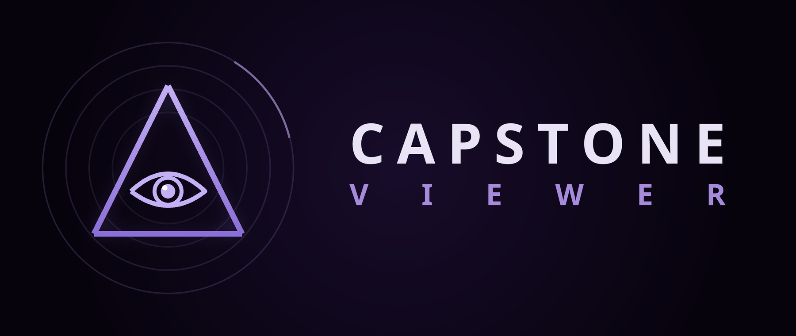
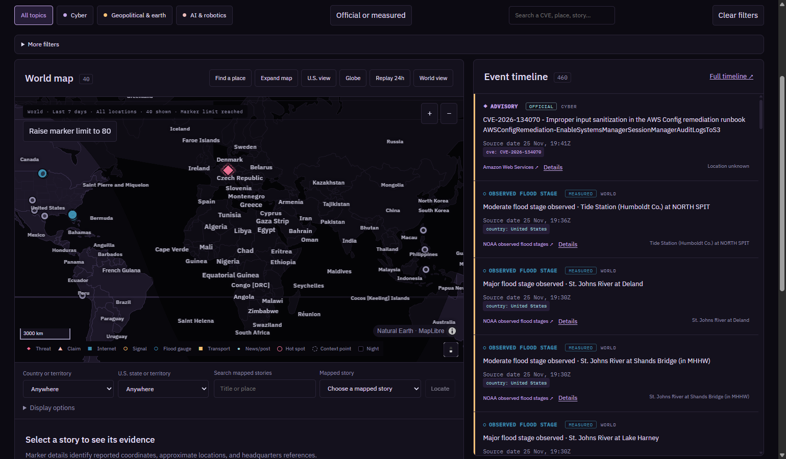

# Capstone Viewer

Capstone Viewer is a local OSINT dashboard for cybersecurity, internet disruptions, and world events. The Windows app can keep collecting from the system tray, with reports and settings stored on your device.

## Demo



[Live Wall](docs/screenshots/live-wall.png) · [Kiosk](docs/screenshots/kiosk.png) · [Timeline](docs/screenshots/timeline.png) · [Feeds](docs/screenshots/feeds.png) · [Sources](docs/screenshots/sources.png)

[Record and add a GIF or MP4](docs/recording-a-demo.md)

## Run locally

Install Node.js 24 or later.

```powershell
npm ci
npm start
```

Open [Operations](http://127.0.0.1:8080/ops). On Windows, run `npm run desktop` for the desktop app. Run `npm test` to check the project.

## What you can do

- **Operations** — Filter the globe and timeline by topic, place, source, and evidence. Open a report for the original link and collection history.
- **Live Wall** — Monitor six default broadcasts, choose backups, and follow headlines by source date or first receipt.
- **Kiosk** — Loop a Cyber, Geopolitical & Earth, or AI & Robotics desk on a second screen. Select a region, review currently listed reports, or pause to explore the map.

## Feed sources

CISA KEV, NVD, national cybersecurity centers, and vendor advisories cover cyber. IODA, RIPE RIS Live, and optional Cloudflare Radar cover connectivity. USGS, NOAA, Environment and Climate Change Canada, the FAA, state DOTs, and BBC, Guardian, and UN feeds cover hazards, transport, and world reporting. GDELT aggregates are available for source review in the timeline.

[Walkthrough and full source list](docs/walkthrough.md) · [Third-party components](THIRD_PARTY.md)
