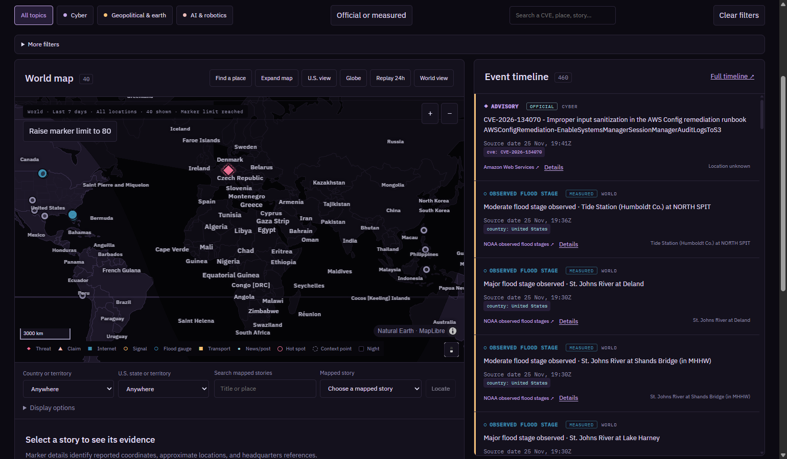
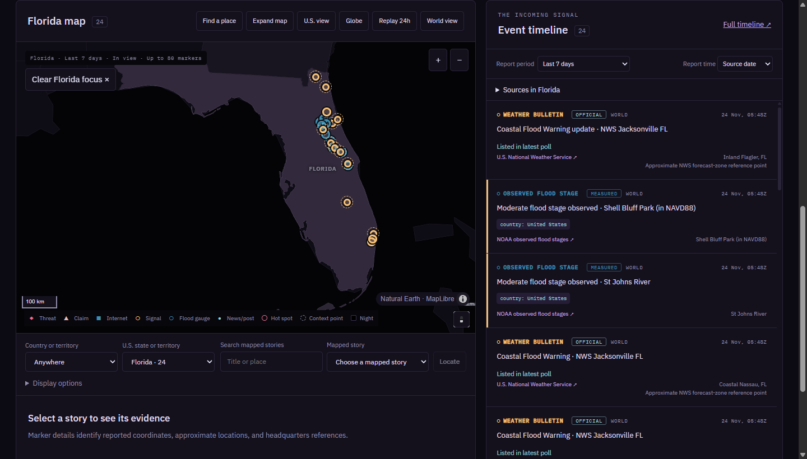
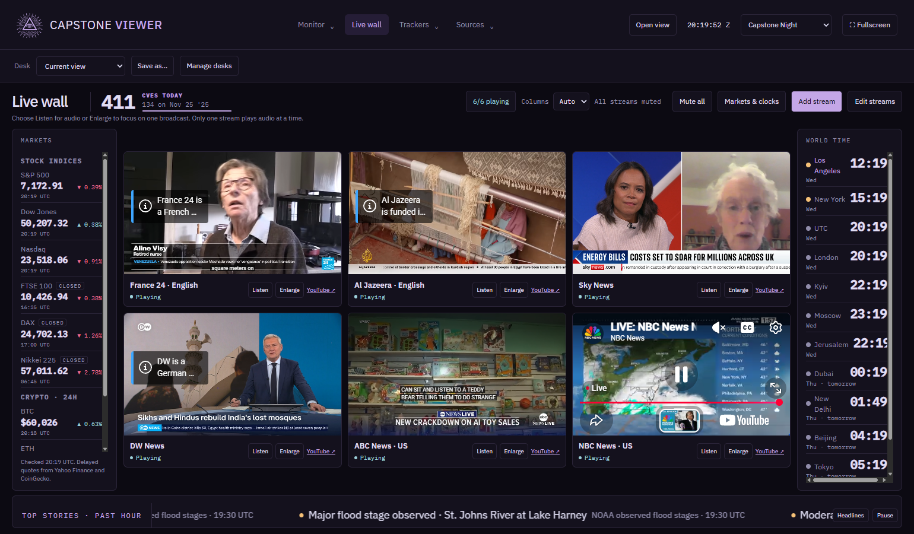
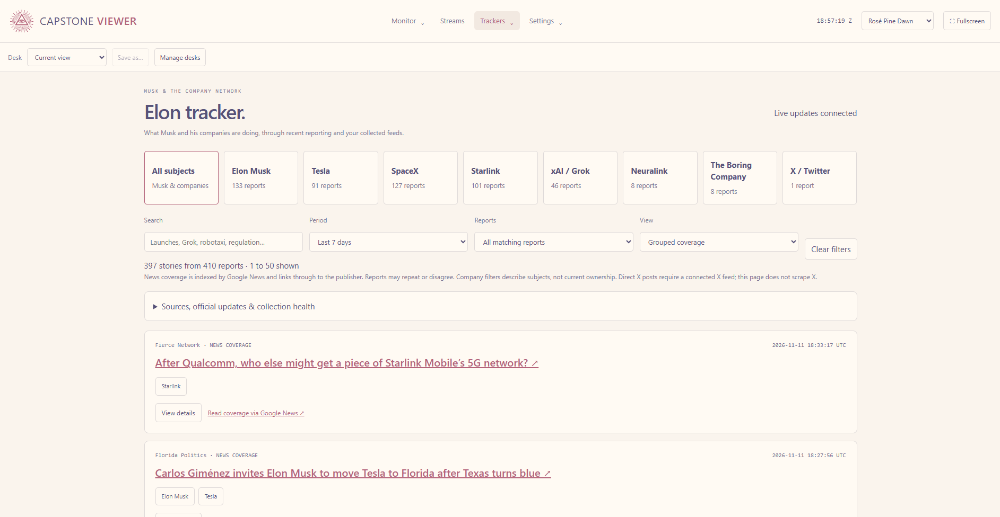
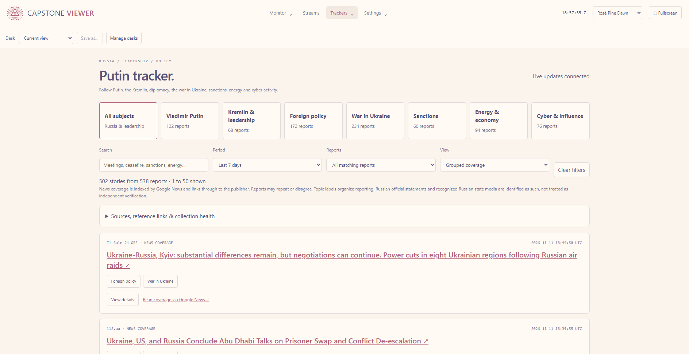
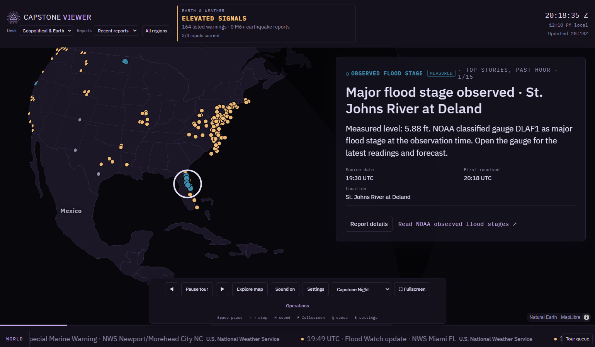

# Capstone Viewer walkthrough

Capstone Viewer is a local OSINT dashboard for monitoring cybersecurity and world events. It combines public feeds, an interactive map, a searchable timeline, and a live news wall. The Windows desktop app keeps collecting from the system tray, and reports and settings stay on your device. In the desktop menu, **View → Startup view** lets you begin in Operations, Live Wall, or Kiosk.

## Run from source

Install Node.js 24 or later, then run:

```powershell
npm ci
npm start
```

Open [Operations](http://127.0.0.1:8080/ops). On Windows, use `npm run desktop` to open the Electron app instead. The desktop app allows up to 60 seconds for the local server to start. If the local port is occupied, it reports the port number in the startup message.

## Main feed and timeline sources

| Area | Built-in sources | What they contribute |
| --- | --- | --- |
| Cybersecurity | CISA Known Exploited Vulnerabilities (KEV), CISA Cybersecurity Advisories, CERT-FR advisories (French), CERT-EU advisories, Canadian Centre for Cyber Security alerts and advisories, UK NCSC publications, Japan Vulnerability Notes, JPCERT/CC security alerts, AWS Security Bulletins, Cisco Security Advisories, NIST National Vulnerability Database (NVD), ransomware.live | Known exploited vulnerabilities, advisories, critical CVEs, and ransomware claims. Canadian entries are dated by the publisher’s update time. [Canadian Cyber Centre bulletins](https://www.cyber.gc.ca/en/alerts-advisories) [AWS bulletins](https://aws.amazon.com/security/security-bulletins/) [Cisco advisories](https://sec.cloudapps.cisco.com/security/center/rss.x) |
| World and natural hazards | BBC World RSS, The Guardian World, UN News, GDELT, USGS, Global Disaster Awareness and Coordination System (GDACS) | World news, machine-coded news aggregates for source review, measured earthquakes of magnitude 4.5 or higher worldwide and 2.5 or higher inside U.S. state and territory or Canadian provincial and territorial boundaries, and modeled disaster alerts. USGS reports show estimated ShakeMap intensity and public felt responses when available. |
| European and Mediterranean earthquakes | EMSC SeismicPortal | Recent regional earthquakes between M3.0 and M4.49, with reported epicenters, depths, and contributing authorities where provided. [EMSC event catalog](https://www.seismicportal.eu/fdsn-wsevent.html) |
| Japan earthquakes | Japan Meteorological Agency | Reports of intensity 3 or higher on the JMA scale, with origin and issue times, source hypocenters, prefectures reporting intensity 3 or higher, and corrections. Capstone selects and formats the records. [JMA earthquake information](https://www.data.jma.go.jp/eqev/data/en/guide/earthinfo.html) |
| Australian earthquakes | Geoscience Australia | Official solutions from M2.0 to below M4.5 in the Australian monitoring area, including reported offshore epicenters. Each record links to its event page and identifies the review status. [Earthquakes@GA](https://earthquakes.ga.gov.au/emailSubscription) |
| New Zealand earthquakes | GeoNet / Earth Sciences New Zealand | Preferred local earthquake solutions with published origin times, epicenters, and estimated shaking at the closest locality. Withdrawals of collected solutions remain in report history. [GeoNet API](https://api.geonet.org.nz/#quakes) |
| Earth observations | NASA Earth Observatory Natural Event Tracker (EONET) | Curated natural-event records, including storm and iceberg tracks when the catalog supplies multiple dated positions. [NASA EONET](https://eonet.gsfc.nasa.gov/docs/v3) |
| Humanitarian emergency records | IFRC GO | Recent public catalog entries from the Red Cross and Red Crescent network. Entries are dated by catalog creation with the incident start listed separately. Single-country records use approximate country points. [GO API](https://go-wiki.ifrc.org/en/go-api/api-overview) |
| Emergency mapping | Copernicus EMS Rapid Mapping | Public natural-hazard mapping activations linked to published mapping products. Map points identify the source's approximate mapping area. |
| U.S. disaster declarations | OpenFEMA | Official federal declarations grouped by state and declaration number, with the declared date, incident period, and named areas. [FEMA source records](https://www.fema.gov/api/open/v2/DisasterDeclarationsSummaries?%24orderby=declarationDate+desc&%24top=5) |
| U.S. wildfire | National Interagency Fire Center (NIFC) | Official wildfire records dated by discovery. Markers show the reported point of origin. |
| British Columbia wildfire | BC Wildfire Service | Recent incident locations with source ignition dates and reported size and control stage. Each record links directly to the provincial incident. [BC Data Catalogue](https://catalogue.data.gov.bc.ca/dataset/2790e3f7-6395-4230-8545-04efb5a18800) |
| U.S. weather | National Weather Service (NWS) | Severe and extreme weather bulletins, with issue times, bulletin expiration, and the areas named by NWS. |
| U.S. local storm impacts | NWS Local Storm Reports | Preliminary reports of tornadoes, flooding, wind damage, landslides, and selected other impacts. Markers use the office’s reported location. Source links show reports in the rolling 72-hour inventory, and Capstone retains collected copies. [NWS storm reports](https://mapservices.weather.noaa.gov/vector/rest/services/obs/nws_local_storm_reports/MapServer) |
| Observed U.S. flood stages | NOAA National Water Prediction Service | Recent measurements from gauges at moderate or major flood stage, scoped to the gauge’s state and dated by the observation. The linked gauge page shows current readings and forecasts. [Observed river stages](https://mapservices.weather.noaa.gov/eventdriven/rest/services/water/riv_gauges/MapServer/0) |
| Tropical cyclones | NOAA National Hurricane Center | Public advisories for tracked Atlantic and Pacific storms. Map markers show the reported storm center with its source time. When Capstone has collected multiple positions, the selected advisory shows the track through that time. [Active tropical cyclones](https://www.nhc.noaa.gov/cyclones/) |
| Canadian weather | Environment and Climate Change Canada | Current official weather warnings with the published risk colour, named forecast areas, and source polygons when available. [Official GeoMet alerts](https://eccc-msc.github.io/open-data/msc-data/alerts/readme_alerts-geomet_en/) |
| England flood alerts and warnings | Environment Agency | Flood alerts, warnings, and published removals for the Environment Agency warning service. Markers use generalized official boundaries where available and GOV.UK flood-area reference points elsewhere. [Current flood areas and notices](https://check-for-flooding.service.gov.uk/alerts-and-warnings) |
| European weather | MeteoAlarm and EUMETNET member weather services | Severe or extreme bulletins from 18 countries, with separate collector status for each country. Coverage includes Austria, Belgium, Czechia, Denmark, Finland, France, Germany, Greece, Iceland, Ireland, Italy, the Netherlands, Norway, Poland, Portugal, Spain, Sweden, and the United Kingdom. [Official feed directory](https://feeds.meteoalarm.org/) |
| Volcano bulletins | [USGS Volcano Notifications](https://volcanoes.usgs.gov/hans-public/), [GeoNet](https://www.geonet.org.nz/volcano/vab) (New Zealand) | Observatory notices with activity and alert levels as issued. Each entry links to the original bulletin. |
| Global volcanic activity | Smithsonian Global Volcanism Program and USGS | Preliminary weekly summaries covering selected volcanoes worldwide, with catalog coordinates and dated report links. [Weekly Volcanic Activity Report](https://volcano.si.edu/reports_weekly.cfm?vtab=report) |
| Tsunami bulletins | NOAA National Tsunami Warning Center and Pacific Tsunami Warning Center | Public bulletins, updates, and cancellations from both centers. Map points mark reported earthquake origins. |
| British Columbia roads | DriveBC Open511 | Road closures with an explicit running time window and source locations. Select **Fit published road segment** on reports with a source line to inspect and export it. [DriveBC Open511 documentation](https://api.open511.gov.bc.ca/help) |
| California highways | Caltrans Lane Closure System | Confirmed full mainline and conventional highway closures across all 12 districts, placed at the reported start point. [Caltrans district feeds](https://cwwp2.dot.ca.gov/lane-closure.html) |
| U.S. work-zone closures | Delaware, Florida, Idaho, Maryland, Mississippi, Missouri, Washington and Wisconsin transportation departments | Full closures in the published direction and time window. Reports identify whether the publisher verified the closure start when the source supplies that information. Map points use the start of the published road geometry. Capstone keeps the retained report and flags an overdue publisher inventory. [U.S. DOT feed registry](https://data.transportation.gov/Roadways-and-Bridges/Work-Zone-Data-Feed-Registry/69qe-yiui) |
| U.S. airport disruptions | FAA National Airspace System Status | Ground stops, ground delay programs, closure and operating notices, departure or arrival delays averaging at least 30 minutes, and deicing. Markers use the airport point and latest poll listing. [FAA NAS Status](https://nasstatus.faa.gov/) |
| Space weather | NOAA Space Weather Prediction Center | Geomagnetic storm watches, warnings, and threshold alerts. |
| Internet and routing | IODA, RIPE RIS Live | Country and U.S. state connectivity measurements, plus alerts for spikes in BGP route withdrawals. State markers use a reference point for the measurement region. |
| AI & robotics | OpenAI News, Google DeepMind, CMU Robotics Institute, IEEE Spectrum Robotics | Company announcements, university robotics updates, and publisher reporting. |

With API credentials, **Cloudflare Radar** adds provider outage annotations and automated detections of possible BGP hijacks. **abuse.ch ThreatFox and URLhaus** add malware indicators and malicious URL reports. You can also track public Telegram, Bluesky, and Mastodon feeds or connect X with an API token.

Use **Collection** in the **Sources** directory to browse built-in feeds or reference links. Built-in feed cards open collector history in Capstone. References include public advisories from Canada and Australia and humanitarian situation reports on ReliefWeb. Japan Vulnerability Notes and JPCERT/CC are collected in English. JVN shows the first publication date alongside a later source update when both are available. [Japan Vulnerability Notes feed documentation](https://jvn.jp/en/rss/)

GDACS adds flood, tropical cyclone, volcanic activity, and orange or red wildfire alerts. Its map markers represent approximate alert areas, and local authorities provide emergency instructions. [GDACS terms and methodology](https://www.gdacs.org/Documents/2025/GDACS_Terms_of_use_Oct_25.pdf)

Copernicus entries use the mapping activation date. When the service omits a timezone, Capstone shows the calendar day. Open the original record for mapped areas and available products. [Copernicus Emergency Response API](https://mapping.emergency.copernicus.eu/about/how-to-harvest-cems-mapping-data/emergency-response-data/)

The weather timeline preserves each bulletin as issued. When NWS explicitly references an earlier bulletin in an update, Operations labels the earlier version as superseded and links to the replacement. Replay shows the earlier marker until the update’s issue time. The report drawer links to the replacements when they are retained on this device. Select **Weather bulletins** in Operations to review them. Check your NWS office for current conditions and instructions. [NWS alerts service](https://www.weather.gov/documentation/services-web-alerts)

Tsunami entries refer to individual official bulletins. Open the bulletin and follow your local authorities for current instructions. [NOAA tsunami coverage and products](https://www.tsunami.gov/?page=productRetrieval)

GDELT aggregates remain available for source review in the full Timeline and through Operations’ **GDELT news coding** filter. They are excluded from Live Wall headlines, the Kiosk tour, and hot-spot activity. Watchlist alerts require explicitly selecting the GDELT collector or report type. [GDELT event database codebook](https://data.gdeltproject.org/documentation/GDELT-Event_Codebook-V2.0.pdf)

The Elon and Putin trackers use dedicated Google News RSS searches. The Operations timeline excludes those tracker-specific results.


## Walkthrough

Use **Open view** or **Ctrl+K** to jump between views, open reports needing re-review, or search the timeline. Choose **Date range · UTC** in Timeline to revisit a fixed period by source date or first receipt. Date ranges can be saved and copied as view links. If Operations reaches its live report limit, it flags the partial view and suspends volume comparisons. Timeline still searches all retained reports.

### Start in Operations



*Scan the Internet, Cyber, Conflict & World, Earth & Weather, and Researcher Chatter status cards, then open a developing story or filter the incoming reports. Select **Official or measured** to focus the map and list on official records and source measurements. Use **More filters → Story evidence** to choose a single evidence label. Saved desks remember the evidence type, report type, and whether muted reports are visible. Choose a specific collector under **More filters → Feed**. The **Full timeline** link carries the collector, desk, search, period, and applicable evidence filters into report history.*

Set **Evidence type** to limit a watchlist to a source classification such as official or measured. Set **Report type** to narrow it further to records such as weather bulletins, mapping activations, or exploited vulnerabilities. Choose a country, U.S. state, or Canadian province or territory to match reported geography. A rule can follow a specific collector without keywords, or use a place plus an evidence or report type. Use **Preview matches** to test the filters against recently collected reports. Copy a citation from report details or from either side of a source-version comparison. Citations include the source date, the relevant receipt time, and a fingerprint of the Capstone record when available. When an assessment has been saved in another window, compare it with your draft before replacing it. The alert inbox searches all retained matches and shows results in pages, including alerts from removed watchlists. Enable **Alert when a matching source report changes** on a watchlist to receive new alerts for source revisions.

### Check collection and changes

1. In **Feeds**, choose a source group such as **Weather** or **Earth hazards & response**. Use **Needs attention** to find failures, overdue collectors, and missing connections. Compare **Last success** with **Newest source date** to see when the collector ran and how recent its reports are. Each built-in collector has **Pause** and **Resume** controls. Operations **Refresh feeds** queues the sources that are due. Feeds shows whether an individual poll is queued or running.
2. Open **History** for the collector, its source website, and its last 24 hours or seven days of polls. The history distinguishes added reports, revisions, unchanged feeds, and errors.
3. In Operations, open a status tile to review the current inputs and thresholds. Outages become **current state unknown** after 20 minutes without a fresh receipt. The routing chart leaves gaps for missing samples.
4. Choose **Since you looked → Copy briefing** for ranked changes with comparison times, source links, and coverage gaps.

### Review and save evidence

1. In **Timeline**, filter by report type or evidence. Choose **More filters → Timeline date → First received** to find reports that arrived recently. The source date stays visible. Select a CVE in the report drawer to find exact references.
2. Open a report to see its first receipt, latest receipt, and retained versions. Compare two receipts or add an **Analyst assessment** with a primary-source link and rationale. Use **Needs re-review** to find assessments affected by a later source revision.
3. Choose **Save report** to retain the report, notes, tags, and assessment past the 30-day window. If another window saved a newer private note, the drawer displays it beside your draft before you replace it.
4. Open **Timeline → Saved reports**, select reports, and choose **Preview briefing** to copy citations, evidence labels, and receipt times. You can include assessments and private notes when needed.

**Compact list** fits more rows on screen. **Hold live list** keeps the current list steady while collection continues. **Download page CSV** exports visible rows, and **Save current view** keeps a reusable set of filters on this device.

### Inspect the globe and timeline



*Florida on November 24, 2026. Blue rings mark measured NOAA flood gauges. Dashed outlines mark approximate forecast-zone reference points.*

Operations opens on the map and timeline with a six-hour report window. Use **What changed** for a briefing since your last visit or **Currently listed** to focus on ongoing notices. Status, story development, and network diagnostics are below the map.

1. **Find a place.** Search by name or code, or sort locations by story count or latest source date. Use **Save place** in a region’s Sources panel to return to it from the **Saved places** filter. Hover over a region to see its matching story count and latest source date. Click a country, or choose **U.S. view** and click a state. Select Canada to see labeled provinces and territories, then click one to inspect its reports. The timeline follows the selection. Click the focused country label again, use the clear button, or press Escape inside the map. Clearing a hot spot restores the previous view and period.
2. **Inspect a report.** Select a marker or use **Search mapped stories** to find a title or place. Marker details explain how the point was placed. **Placements** lets you hide headquarters or show reported coordinates. If the marker limit hides matching stories, the map shows a control to raise it. **Fit published warning area** zooms to a bulletin outline. Approximate NWS points are labeled with the forecast, marine, or state reference used. [NWS alert geolocation guide](https://www.weather.gov/media/documentation/docs/NWS_Geolocation.pdf)
3. **Check regional coverage.** Open **Sources in [place]** to see which regional collectors have checked in recently and which are paused, overdue, or failing. Compare each collector’s last successful poll with its matching reports in the selected area, period, and filters. **Area briefing** previews those checks and up to 12 matching reports with evidence labels, dates, and source links. Poll history opens the source and recent collection attempts. **Full timeline** carries the state, province, or country into the archive. Use **View on map** on a located retained report to inspect its source position or published outline. **Set up a watchlist for this area** opens a draft for that region.
4. **Add live weather imagery.** In **Display options**, select NOAA radar or global infrared satellite imagery. The map displays the published image time. **Show weather areas from latest polls** overlays published polygons from recent successful polls within their source validity window. Choose **U.S. severe-weather outlook** to see the Storm Prediction Center’s Day 1 or Day 2 forecast areas, their risk categories, and their issue and validity times. [NOAA outlooks](https://www.spc.noaa.gov/products/outlook/) [NOAA nowCOAST](https://nowcoast.noaa.gov/)
5. **Review change over time.** Use **Currently listed** in Operations or Timeline for weather and transportation notices and network detections that still appear in recent successful polls, including reports issued before today. Use **Last hour** or **Last 6 hours** for recent reports. Select **First received** to focus the map and list on reports Capstone recently collected, including reports with an older source date. **Replay 24h** uses source times and holds the report list while collection continues. Live imagery pauses during replay. **Fit observation track** shows the dated positions for a selected NASA observation or collected hurricane advisories.
6. **Set up the viewing area.** **Expand map** puts the timeline below a wider map. Adjust the live marker limit, marker order, extent, night shading, and country report-count shading under **Display options**. Automatic limits allow 40 markers worldwide and 80 in a focused geography. Use **Spread across places** to give separate locations room when one area has many reports. **Copy map link** preserves the position, projection, period, time basis, filters, display settings, and selected report. Use **Download GeoJSON** to open the mapped points and available source outlines or tracks in a GIS, with source links, dates, and location basis. Weather and transportation exports carry the published end time and, during live collection, the latest listing’s freshness cutoff.

### Link a personal account

Open **Feeds → Personal accounts**. For X, register a read-only Native App once, enter its Client ID, then approve the connection in your browser. The optional **Following** feed starts paused and keeps posts from public authors. X API reads may use developer credits. [X sign-in documentation](https://docs.x.com/fundamentals/authentication/oauth-2-0/authorization-code)

For Telegram, enter an app API ID and hash once, scan the QR code in **Telegram → Settings → Devices**, then search or select the public channels to track. The picker marks channels already in Tracked feeds. Capstone collects those channels through public previews after you add them. The Windows desktop app encrypts account sessions, and the standalone server keeps them for the current process. [Telegram API setup](https://core.telegram.org/api/obtaining_api_id/) [Telegram QR sign-in](https://core.telegram.org/api/qr-login)

### Open the live wall



*The six-screen wall displays live video, market prices, world clocks, and a headline crawl.*

- **Set up the broadcasts.** The default lineup is France 24 English, Al Jazeera English, Sky News, DW News, ABC News US, and NBC News US. Choose **Columns → 3** to match the screenshot. Reset a saved lineup through **Edit streams → Use defaults → Save streams**.
- **Watch and listen.** Select **Listen** for one broadcast at a time and **Enlarge** to focus on a tile. In the Windows app, use **Ctrl+Plus** or **Ctrl+Equals** to zoom in and **Ctrl+Minus** to zoom out.
- **Check a stalled broadcast.** Select the playing count to see the primary failure, backup, and next retry. Retry one tile or all unavailable tiles. Temporary failures retry automatically, including direct video links, and waiting tiles retry when the wall regains its connection. Choose a broadcaster or enter a custom YouTube link under **Edit streams → Backup broadcast**. ABC tries CBS News 24/7, LiveNOW from FOX, and NBC News when those channels are available and absent from the wall.
- **Read the headlines.** Open **Headlines** for the list, evidence filters, watchlist-only view, and retained report details. The filters also scope the crawl. **Headline time → First received** surfaces newly collected reports even when their publisher dates are older. Pause to hold the crawl and scroll it manually. New headlines wait until you resume. Selecting a RIPE routing alert opens the stored measurement and its provider reference.
- **Make room for video.** **Markets & clocks** opens both panels and lets you pick which sit beside the streams. In fullscreen, open **Wall controls** in the headline bar to change layout, check broadcast status, or edit streams. The panels scroll independently. Markets shows delayed quote times in UTC and labels held quotes **Last known**. Saved Live Wall desks remember the lineup, headline filters, columns, and sidebars. Editing or moving tiles preserves unchanged broadcasts in the desktop app.

### Follow the trackers



*Filter coverage of Musk and his companies by subject, time period, and report type, then follow the links to the original coverage.*



*Follow Putin and the Kremlin by topic. The tracker labels official statements and recognized state media so readers can distinguish their provenance. Both trackers let you hold the list during review and copy a link to your filters.*

### Put Kiosk on another screen

In Live Wall, open **Headlines → Open this desk in Kiosk** to start a separate Kiosk with the same desk, evidence filter, time basis, and watchlist choice.



*Kiosk rotates through sourced reports with a map, signal tiles, and a headline crawl.*

- **Choose what rotates.** Set **Desk** to **Cyber**, **Geopolitical & Earth**, or **AI & Robotics**. Use the region button to search by name or code and focus on a country, U.S. state, or Canadian province. Kiosk outlines the region on the map. **Explore map** holds the tour so you can navigate the globe and select mapped points to open their reports. When points overlap, choose a report from the list at that location. The simplified map takes over if the globe fails to load or recover. The focused report can add a published warning area, road segment, or observation track. **Settings → Evidence → Official or measured** narrows the source classes. Enable **Watchlist matches only** to keep the tour focused on your rules. The selection scopes the tour, map points, crawl, and on-screen watchlist alerts. Scoped views display matching story or listing counts and the number of stops in the rotation.
- **Watch new arrivals.** Set **Settings → Recent report time → First received** to see reports newly collected by Capstone, including older source publications. Report cards show the source date and first receipt.
- **Watch current listings.** **Reports → Currently listed** rotates through weather, road, airport, and network reports while their listings stay fresh. Select **Cyber** for network detections only. Listings drop when they expire or live collection is unavailable. **Source checks** shows which providers reported an empty inventory and which have missing, failed, or overdue coverage.
- **Keep separate monitor views.** Each Kiosk window can have its own filters. Choose **Settings → Copy current view link** to keep the desk, region, report mode, time basis, evidence, and watchlist selection. Open `/kiosk?desk=cyber` for Cyber or `/kiosk?desk=geo&state=WA` for Geopolitical & Earth in Washington. Choose **All desks** with **All regions** to include mixed hot spots.
- **Stay on a report.** Open **Tour queue** or press **Q** to choose a report and hold it on screen. **Report details** opens the retained source in Kiosk. In narrow windows, report text scrolls above the source buttons, and **Controls** opens the tour toolbar. **Open in Operations** opens that report in the map and timeline view. Pause to scroll the crawl manually. Resume or use the arrow keys to step through the scope.
- **Inspect coverage.** Global status tiles open their counts, thresholds, and sources. Regional views show collector checks and last successful polls. The clock rail flags paused collection and old snapshots.

After a collection interruption, use **Collection gap** in Kiosk or open **Headlines** in Live Wall for the recorded time window. **Show first receipts** switches to reports Capstone recently collected.

### Choose a theme

The dropdown next to **Fullscreen**, visible in the tracker and kiosk screenshots, includes all eleven Corpus Magnus themes plus **Capstone Night**. The Light and Dark groups make it easy to switch directly to a palette. Your choice is saved and follows open Capstone windows. Choose **Sleek → Matrix** for the green-on-black monospace palette. Earlier screenshots show the original icon control.

### Keep collection running

After a long Windows sleep, Operations shows the recorded collection gap and the collectors resume on their regular schedules. Open **Feeds → Local backups** to see the latest daily copy or create a manual database backup. Backups contain reports, saved evidence, notes, assessments, watchlists, and feed choices. Browser-only settings such as the theme and stream lineup are stored separately.

Run `npm test` to check the project. See [Third-party components](../THIRD_PARTY.md) for bundled libraries and data sources.
